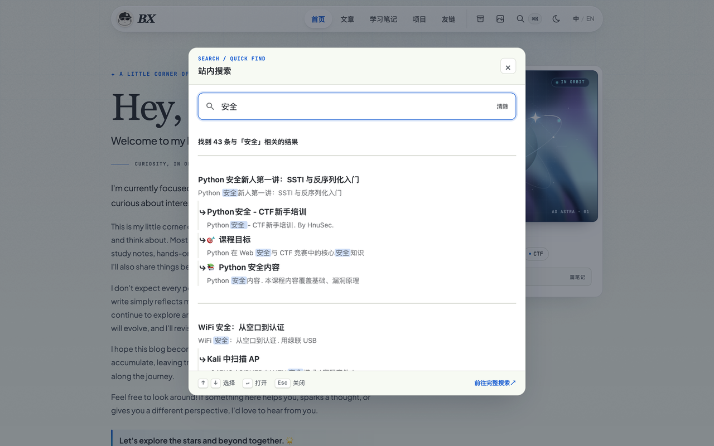
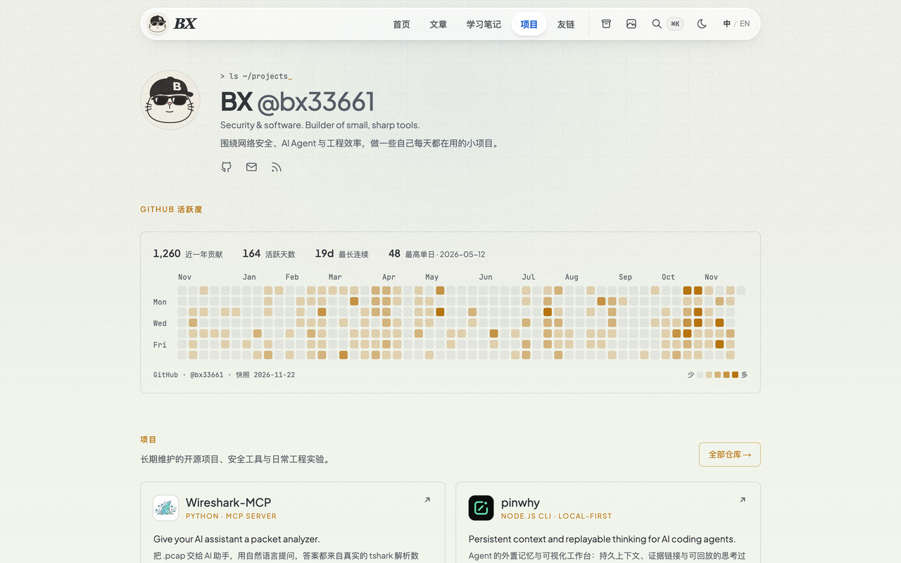
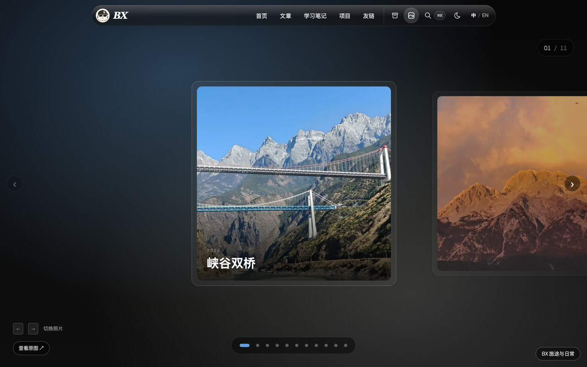

<div align="center">
  
  <h1>BX's Blog</h1>
  <p>
    <strong>网络安全 · CTF · Web 安全 · AI 安全与工程实践 — 基于 Astro Orbit 构建的双语个人技术博客。</strong>
  </p>

  <p>
    <a href="https://www.bx33661.com">在线访问</a> ·
    <a href="https://www.bx33661.com/blog/">文章</a> ·
    <a href="https://www.bx33661.com/notes/">短记</a> ·
    <a href="https://www.bx33661.com/projects/">项目</a> ·
    <a href="https://www.bx33661.com/en/">English</a> ·
    <a href="https://github.com/bx33661/astro-orbit">使用同款模板 ↗</a>
  </p>

  <p>
    <a href="https://github.com/bx33661/bx33661.github.io/actions/workflows/deploy.yml"></a>
    <a href="https://www.bx33661.com"></a>
    <a href="https://github.com/bx33661/astro-orbit"></a>
    <a href="https://astro.build"></a>
    <a href="https://tailwindcss.com"></a>
    <a href="https://pagefind.app"></a>
  </p>
</div>

<p align="center">
  <a href="https://www.bx33661.com">
    <picture>
      <source media="(prefers-color-scheme: dark)" srcset="./docs/screenshots/hero-dark.png" />
      <source media="(prefers-color-scheme: light)" srcset="./docs/screenshots/hero-light.png" />
      
    </picture>
  </a>
</p>

---

## 界面一览

<table>
  <tr>
    <td width="50%" align="center">
      
      <br />
      <strong>沉浸长文阅读</strong> · 目录大纲、Callouts、KaTeX 与 Shiki 代码高亮
    </td>
    <td width="50%" align="center">
      
      <br />
      <strong>零后端全站检索</strong> · 静态 Pagefind 索引（<code>⌘K</code> 快捷键）
    </td>
  </tr>
  <tr>
    <td width="50%" align="center">
      
      <br />
      <strong>项目与活跃度</strong> · 开源项目展示与 GitHub 贡献日历
    </td>
    <td width="50%" align="center">
      
      <br />
      <strong>视觉画廊</strong> · 氛围光影轮播、原生灯箱与响应式高清图像
    </td>
  </tr>
</table>

---

## 站点导览

| 模块       | 路径                                                | 说明                                            |
| :--------- | :-------------------------------------------------- | :---------------------------------------------- |
| **文章**   | [`/blog/`](https://www.bx33661.com/blog/)           | 漏洞分析、CTF Writeup、Web / AI 安全与工程实践  |
| **短记**   | [`/notes/`](https://www.bx33661.com/notes/)         | 碎片思考、排查备忘与实验记录                    |
| **项目**   | [`/projects/`](https://www.bx33661.com/projects/)   | 开源工具与安全研究项目展示                      |
| **相册**   | [`/galleries/`](https://www.bx33661.com/galleries/) | 旅途与日常视觉画廊                              |
| **检索**   | [`/search/`](https://www.bx33661.com/search/)       | Pagefind 构建期静态双语全文检索                 |
| **友链**   | [`/friends/`](https://www.bx33661.com/friends/)     | 朋友站点、安全团队与研究组织                    |
| **英文版** | [`/en/`](https://www.bx33661.com/en/)               | 英文首页、文章、短记、归档与独立 RSS / 搜索索引 |

---

## 同款模板 · Astro Orbit

> 本仓库承载 BX 的个人博客内容、历史文章、域名（`CNAME`）与站内个人数据。

如果你想搭建同款双语学术 / 技术博客，请直接使用独立维护的开源模板仓库 **[`bx33661/astro-orbit`](https://github.com/bx33661/astro-orbit)**，无需 Fork 本仓库手动清理文章与隐私配置：

```bash
npm create astro@latest -- --template bx33661/astro-orbit
```

---

## 本地写作与上游同步

日常本地写作、校验与从上游模板 [`bx33661/astro-orbit`](https://github.com/bx33661/astro-orbit) 同步通用更新（详见 [`docs/UPSTREAM_SYNC.md`](./docs/UPSTREAM_SYNC.md)）：

```bash
# 1. 安装依赖与启动本地开发服务器（http://localhost:4321）
npm ci
npm run dev

# 2. 新建文章或笔记草稿，并在提交前执行完整验证
npm run content:new -- --title "文章标题" --slug "post-slug"
npm run verify:quick     # ESLint + astro check + 单元测试 + 内容校验
npm run verify:full      # 完整检查 + 生产构建 + 产物冒烟 + Playwright 回归

# 3. 从 astro-orbit 同步通用能力更新
git fetch upstream && git merge upstream/main
```

---

<details>
<summary><strong>目录结构</strong></summary>

```text
src/
  config.ts          # 站点元信息、多语言主页文案与全局身份配置
  config/            # 友链分组与环境变量读取
  content/blog/      # Markdown / MDX 技术文章（含中英文对照）
  data/              # notes、galleries、系列文章与学术数据
  pages/             # 中英文路由、RSS、Sitemap 与动态 manifest
  components/        # 通用模板组件与博客专属交互专题组件
  layouts/           # Layout / Main / PostDetails
public/              # 静态资源、CNAME、_headers、_redirects、sw.js
scripts/           # 内容脚手架、冒烟测试、Playwright 回归、SEO 推送脚本
.github/workflows/ # GitHub Pages 构建部署、百度/IndexNow 通知工作流
docs/              # 工程文档、上游同步说明与展示截图
```

</details>

<details>
<summary><strong>常用 CLI 命令</strong></summary>

| 命令                                     | 说明                                                  |
| :--------------------------------------- | :---------------------------------------------------- |
| `npm run cli`                            | 打开命令行工具面板                                    |
| `npm run dev` / `dev:force` / `dev:stop` | 智能开发服务器与锁文件/端口管理                       |
| `npm run harness:doctor`                 | 检查本地 Node、依赖、Git 状态与预览端口健康度         |
| `npm run content:new` / `content:check`  | 新建文章脚手架与 Frontmatter、图片、slug 校验         |
| `npm run build` / `npm run preview`      | 生产构建 + Pagefind 搜索索引 / 本地预览产物           |
| `npm run verify:quick` / `verify:full`   | 快速静态与单测检查 / 全量构建与 Playwright 浏览器回归 |
| `npm run smoke:site`                     | 对 `dist/` 执行站点路由、字体与组件结构冒烟检查       |
| `npm run gallery:optimize`               | 生成相册多分辨率优化图像                              |
| `npm run baidu:push` / `seo:check`       | 百度收录推送与线上 SEO 元信息校验                     |

</details>

<details>
<summary><strong>环境变量与自动部署</strong></summary>

完整变量说明见 [`.env.example`](./.env.example)：

| 变量                                         | 说明                                      |
| :------------------------------------------- | :---------------------------------------- |
| `SITE` / `BASE_URL`                          | 站点 Origin 与 Base Path                  |
| `PUBLIC_ENABLE_ANALYTICS`                    | 统计分析开关                              |
| `PUBLIC_ENABLE_COMMENTS` / `PUBLIC_GISCUS_*` | Giscus 评论开关与仓库配置                 |
| `BAIDU_PUSH_TOKEN`                           | 百度推送 Token（仅存放在 GitHub Secrets） |

推送至 `main` 后，[`.github/workflows/deploy.yml`](./.github/workflows/deploy.yml) 会自动执行：

1. `npm ci` 与 `npm run verify:full`（关闭线上统计/评论开关执行全量检查与浏览器回归）
2. 若启用了评论或统计变量，则以生产环境变量重编 `dist/` 并执行 `npm run smoke:dist`
3. 发布 `dist/` 至 GitHub Pages（自定义域名 `www.bx33661.com` 由 `public/CNAME` 绑定，边缘规则见 [`docs/EDGE_SETUP.md`](./docs/EDGE_SETUP.md)）
4. 触发 `.github/workflows/baidu-notify.yml` 推送百度与 IndexNow 收录通知（仓库社交预览图位于 `docs/github-social.png`）

</details>

---

<p align="center">
  <a href="https://www.bx33661.com">www.bx33661.com</a> ·
  <a href="mailto:bx33661@gmail.com">bx33661@gmail.com</a> ·
  <a href="https://www.bx33661.com/.well-known/security.txt">security.txt</a>
</p>
