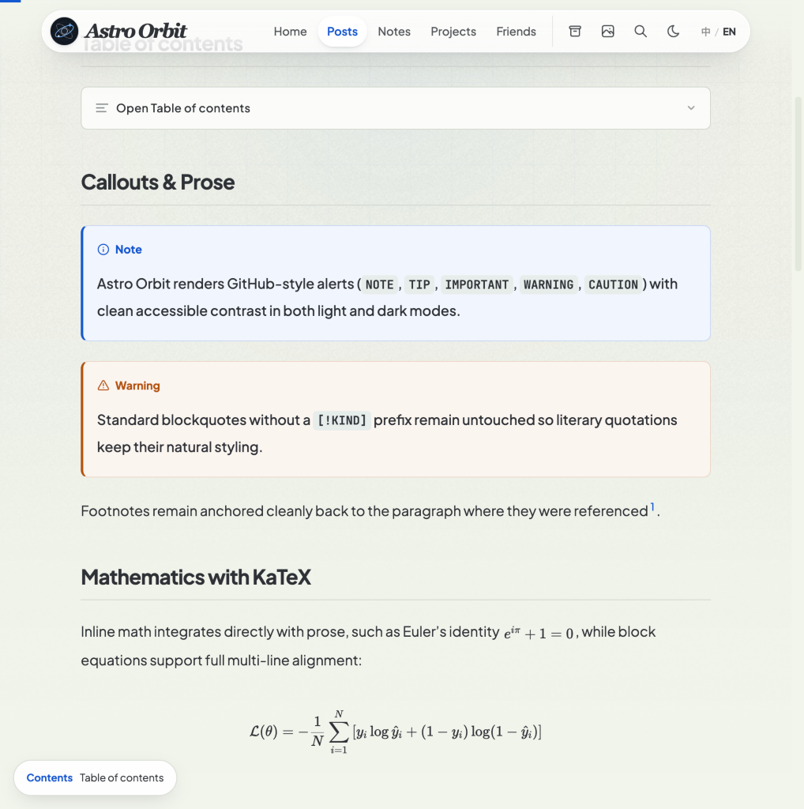

<div align="center">
  
  <h1>Astro Orbit</h1>
  <p>
    <strong>A bilingual editorial technical blog &amp; personal knowledge base template built with Astro 7, Tailwind CSS 4, MDX, and Pagefind.</strong>
  </p>

  <p>
    <strong>English</strong> · <a href="./README.zh-CN.md">简体中文</a>
  </p>

  <p>
    <a href="https://bx33661.github.io/astro-orbit/">Live Demo</a> ·
    <a href="#quick-start">Quick Start</a> ·
    <a href="./docs/CUSTOMIZATION.md">Customization Guide</a> ·
    <a href="https://github.com/bx33661/astro-orbit/issues/new?template=bug_report.yml">Report Bug</a>
  </p>

  <p>
    <a href="https://github.com/bx33661/astro-orbit/actions/workflows/ci.yml"></a>
    <a href="https://github.com/bx33661/astro-orbit/actions/workflows/deploy.yml"></a>
    <a href="https://astro.build"></a>
    <a href="https://tailwindcss.com"></a>
    <a href="https://pagefind.app"></a>
    <a href="./LICENSE"></a>
  </p>
</div>

<p align="center">
  <a href="https://bx33661.github.io/astro-orbit/">
    <picture>
      <source media="(prefers-color-scheme: dark)" srcset="./docs/screenshots/hero-dark.png" />
      <source media="(prefers-color-scheme: light)" srcset="./docs/screenshots/hero-light.png" />
      
    </picture>
  </a>
</p>

---

## Visual Tour

<table>
  <tr>
    <td width="50%" align="center">
      
      <br />
      <strong>Long-Form Reading</strong> · KaTeX, Mermaid, Shiki &amp; Callouts
    </td>
    <td width="50%" align="center">
      
      <br />
      <strong>Zero-Backend Search</strong> · Static Pagefind (<code>⌘K</code> Modal)
    </td>
  </tr>
  <tr>
    <td width="50%" align="center">
      
      <br />
      <strong>Projects &amp; Activity</strong> · Showcase Grid &amp; Contribution Calendar
    </td>
    <td width="50%" align="center">
      
      <br />
      <strong>Galleries</strong> · Ambient Slider, Lightbox &amp; AVIF/WebP Renditions
    </td>
  </tr>
</table>

---

## Why Astro Orbit?

- **Paper-Inspired Design &amp; WebGPU Observatory**: Editorial typography, light/dark themes with button-centered View Transitions reveal, liquid-glass navigation, and a zero-overhead precompiled WebGPU star-map shader.
- **Native Bilingual or Single-Language**: English at `/` and Chinese at `/zh/` out of the box—flip `DEFAULT_LOCALE` or set `BILINGUAL = false` in one line. Every navigation label, callout, footnote, gallery control, and dev check stays localized.
- **Zero-Code Theme Engine (`src/config.ts`)**: Switch between 6 curated accent presets (or supply custom hex colors) and watch CSS tokens and dynamic Satori OG images update in lockstep.
- **Complete Technical Authoring Pipeline**: MDX, GFM tables, KaTeX math, Mermaid diagrams, GitHub callouts, Shiki code blocks with filenames and folding, series navigation, and build-time image sizing.
- **Offline-Ready Static Search &amp; PWA**: Client-side Pagefind full-text indexing across locales (`en` + `zh-cn`), full subpath (`BASE_URL`) support, RSS feeds, and webmanifest generation.
- **Privacy-First &amp; Self-Hosted Fonts**: Open-source Plus Jakarta Sans &amp; JetBrains Mono bundled via Astro 7's native Fonts API, strict CSP with dynamic allowlisting for optional Umami / Plausible / GA4 analytics and Giscus comments.

---

## Quick Start

Create a new project via the Astro CLI, run the setup wizard, and remove demo content whenever you are ready:

```bash
# 1. Scaffold from the template
npm create astro@latest -- --template bx33661/astro-orbit

# 2. Configure title, author, URL, theme preset, languages & modules
npm run setup

# 3. Optional: remove starter demo posts & galleries (adds a clean hello-world.md)
npm run clean:demo -- --yes

# 4. Start the local dev server
npm run dev
```

Open `http://localhost:4321` in your browser. Requires **Node.js `>=22.12.0`**.

---

## Theme Presets

Set `THEME_PRESET` in [`src/config.ts`](./src/config.ts) (or set `accentLight` / `accentDark` for custom brand colors). Generated Open Graph cards automatically adopt your active palette.

| Preset | Light Accent | Dark Accent | Character |
|---|---|---|---|
| `cobalt` *(default)* |  |  | Deep sky ink &amp; crisp astronomical blue |
| `emerald` |  |  | Botanical teal &amp; luminous mint |
| `amber` |  |  | Warm ochre &amp; observatory gold |
| `violet` |  |  | Editorial indigo &amp; ultraviolet |
| `rose` |  |  | Carmine print &amp; coral glow |
| `slate` |  |  | Monochrome ink &amp; cool graphite |

---

## One-Click Deploy

<p>
  <a href="https://vercel.com/new/clone?repository-url=https%3A%2F%2Fgithub.com%2Fbx33661%2Fastro-orbit"></a>
  &nbsp;
  <a href="https://app.netlify.com/start/deploy?repository=https://github.com/bx33661/astro-orbit"></a>
</p>

- **GitHub Pages**: Enable **Settings → Pages → Source: GitHub Actions**. [`.github/workflows/deploy.yml`](./.github/workflows/deploy.yml) automatically detects your `SITE` and subpath `BASE_URL`.
- **Vercel / Netlify / Cloudflare Pages**: Pre-configured with [`vercel.json`](./vercel.json) and [`netlify.toml`](./netlify.toml) (build command `npm run build`, output directory `dist`, Node `22`).

---

<details>
<summary><strong>Configuration Highlights (<code>src/config.ts</code>)</strong></summary>

All primary identity, copy, styling, and module toggles live in [`src/config.ts`](./src/config.ts)—see [`docs/CUSTOMIZATION.md`](./docs/CUSTOMIZATION.md) for the full recipe book:

- **Language &amp; Routing**: `DEFAULT_LOCALE` (`"en"` | `"zh-CN"`), `BILINGUAL` (`true` | `false`)
- **Appearance**: `THEME_PRESET`, `THEME_DEFAULT_MODE` (`"system"` | `"light"` | `"dark"`), optional `accentLight` / `accentDark`
- **Socials &amp; Share**: `SITE.socials` (`github`, `x`, `linkedin`, `mail`, `telegram`, `globe`, `rss`) and `SITE.shareLinks`
- **Feature Toggles (`FEATURES`)**: `notes`, `projects`, `friends`, `galleries`, `archives`, `search`, `githubHeatmap`, `pwa`, `dynamicOgImage`, `lightAndDarkMode`, `showBackButton`
- **Optional Integrations ([`.env.example`](./.env.example))**: Umami, Plausible, GA4 analytics (`PUBLIC_ENABLE_ANALYTICS=true`) and Giscus comments (`PUBLIC_ENABLE_COMMENTS=true`)

</details>

<details>
<summary><strong>Project Structure</strong></summary>

```text
src/
  config.ts              # Single source of truth for site settings, theme, socials, & modules
  config/friends.ts      # Friend directory groups
  content/blog/          # Long-form articles (.md / .mdx)
  data/notes/            # Study notes (.md / .mdx)
  data/galleries/        # Gallery albums (<slug>/index.md + source images)
  data/projects.ts       # Project showcase entries
  data/article-series.ts # Curated multi-part series
public/
  brand/                 # Logo SVGs, PNGs, apple-touch-icon, favicon.ico
  gallery/optimized/     # Generated responsive AVIF / WebP / JPG assets
scripts/                 # Interactive setup, clean:demo, content tooling, and Node tests
```

</details>

<details>
<summary><strong>CLI Scripts Reference</strong></summary>

| Command | Description |
|---|---|
| `npm run setup` | Interactive wizard to customize `src/config.ts` |
| `npm run clean:demo` | Remove starter demo posts, notes &amp; gallery assets (`--dry-run` / `--yes`) |
| `npm run dev` | Start dev server with duplicate-process guard |
| `npm run build` | Build static site (`dist/`) + Pagefind search index |
| `npm run preview` | Preview built `dist/` locally |
| `npm run cli` | Open the Astro Orbit CLI overview |
| `npm run content:new` | Scaffold a new blog post or note draft (`--title`, `--type`, `--lang`) |
| `npm run content:check` | Validate frontmatter, slugs, and local image paths |
| `npm run gallery:optimize` | Generate responsive AVIF / WebP / JPG renditions |
| `npm run github:contributions` | Refresh GitHub heatmap snapshot (`gh` CLI required) |
| `npm run template:check` | Audit remaining starter placeholder defaults (`--strict` for CI) |
| `npm run verify:full` | Run ESLint, `astro check`, unit tests, `content:check`, `build`, and `smoke:dist` |

</details>

---

## Contributing & License

Contributions, bug reports, and ideas are welcome—see [`CONTRIBUTING.md`](./CONTRIBUTING.md) before opening a pull request.

Released under the [MIT License](./LICENSE).
