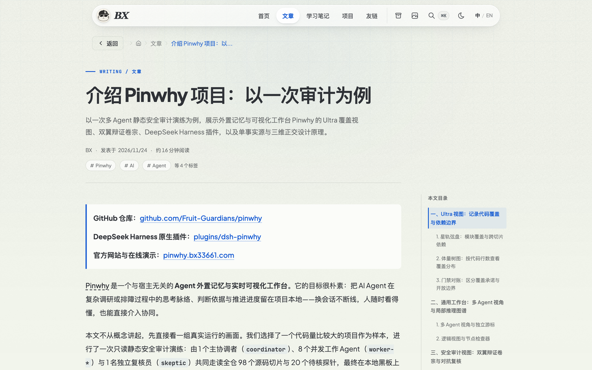
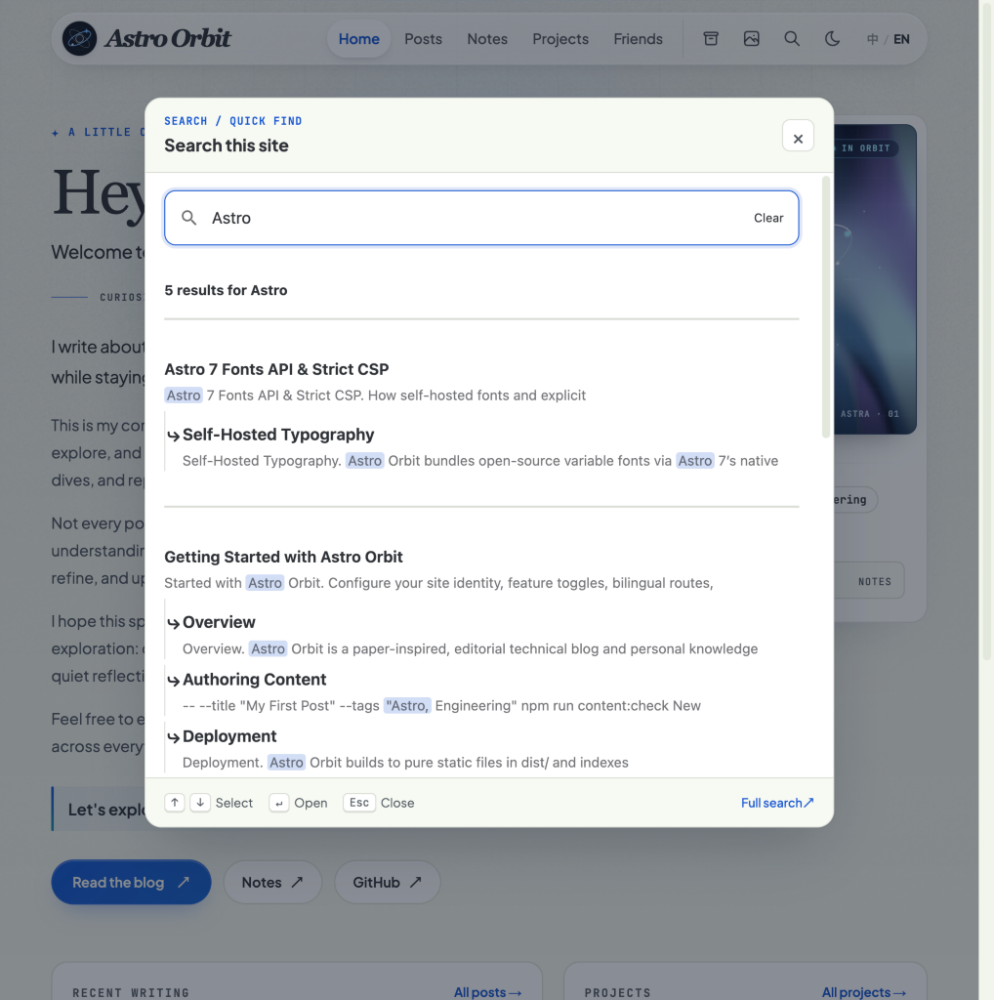
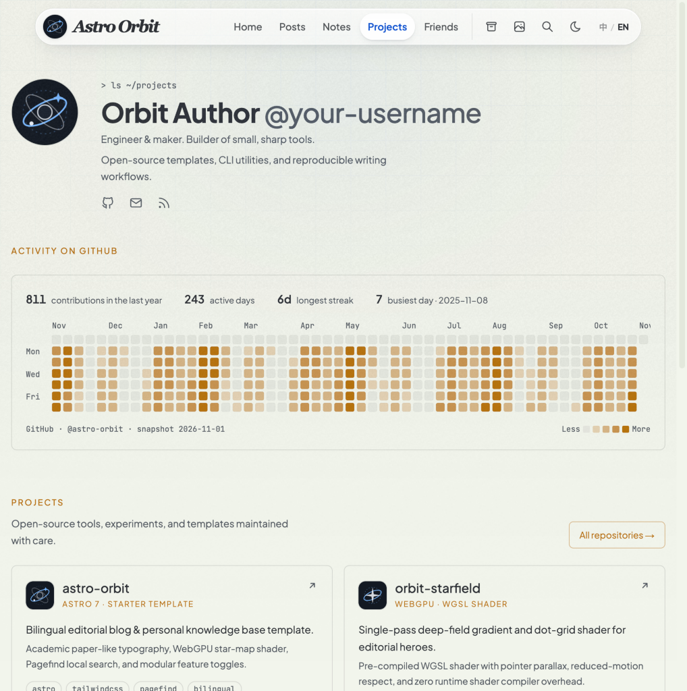
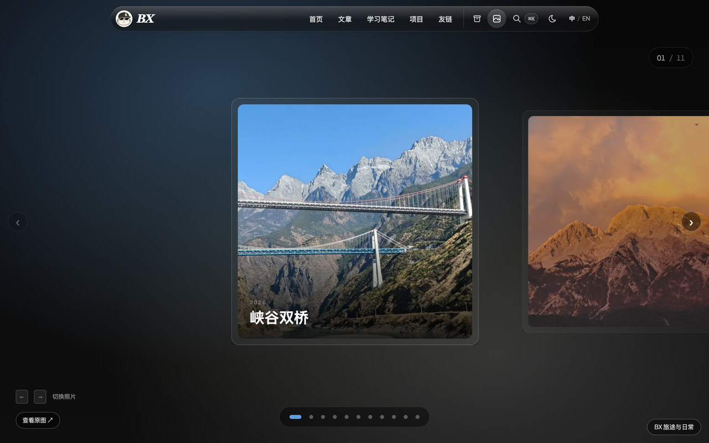

<div align="center">
  
  <h1>Astro Orbit</h1>
  <p>
    <strong>基于 Astro 7、Tailwind CSS 4、MDX 与 Pagefind 构建的双语学术风技术博客与个人知识库模板。</strong>
  </p>

  <p>
    <a href="./README.md">English</a> · <strong>简体中文</strong>
  </p>

  <p>
    <a href="https://www.bx33661.com/astro-orbit/">在线演示</a> ·
    <a href="#快速开始">快速开始</a> ·
    <a href="./docs/CUSTOMIZATION.md">定制指南</a> ·
    <a href="https://github.com/bx33661/astro-orbit/issues/new?template=bug_report.yml">问题反馈</a>
  </p>

  <p>
    <a href="https://github.com/bx33661/astro-orbit/actions/workflows/ci.yml"></a>
    <a href="https://github.com/bx33661/astro-orbit/actions/workflows/deploy.yml"></a>
    <a href="https://astro.build"></a>
    <a href="https://tailwindcss.com"></a>
    <a href="https://pagefind.app"></a>
    <a href="./LICENSE"></a>
  </p>
</div>

<p align="center">
  <a href="https://www.bx33661.com/astro-orbit/">
    <picture>
      <source media="(prefers-color-scheme: dark)" srcset="./docs/screenshots/hero-dark.png" />
      <source media="(prefers-color-scheme: light)" srcset="./docs/screenshots/hero-light.png" />
      
    </picture>
  </a>
</p>

---

## 界面一览

<table>
  <tr>
    <td width="50%" align="center">
      
      <br />
      <strong>沉浸长文阅读</strong> · KaTeX 公式、Mermaid 图表、Shiki 与 Callouts
    </td>
    <td width="50%" align="center">
      
      <br />
      <strong>零后端全站检索</strong> · 静态 Pagefind 索引（<code>⌘K</code> 快捷键）
    </td>
  </tr>
  <tr>
    <td width="50%" align="center">
      
      <br />
      <strong>项目与活跃度</strong> · 项目卡片展示与 GitHub 贡献热力图
    </td>
    <td width="50%" align="center">
      
      <br />
      <strong>视觉画廊</strong> · 氛围光影轮播、原生灯箱与 AVIF/WebP 响应式图片
    </td>
  </tr>
</table>

---

## 核心特性

- **纸感学术排版与 WebGPU 星图视界**：温和阅读对比度、按钮圆心 View Transitions 明暗切换动画、液态玻璃胶囊导航栏，以及零编译开销的单 Pass WebGPU 星图 Shader。
- **原生双语或纯单语切换**：开箱即用英文（`/`）+ 中文（`/zh/`）路由，也可一行代码将 `DEFAULT_LOCALE` 切换为 `"zh-CN"` 或关闭双语模式；导航、Callouts、脚注、相册控件与开发巡检工具均已完整双语化。
- **零侵入单文件配置引擎（`src/config.ts`）**：内置 6 套精选强调色预设与自定义主色支持，动态 Satori OG 分享图与 CSS `--accent` 变量自动保持同步。
- **完备的技术写作流水线**：支持 MDX、GFM 表格/任务列表、KaTeX 公式、Mermaid 流程图、GitHub Callouts、Shiki 代码文件名/高亮/Diff/长代码折叠、系列文章导航与构建期本地图片尺寸推断。
- **离线可用本地搜索与 PWA**：生产构建自动生成双语（`en` + `zh-cn`）Pagefind 全站索引，完整兼容 GitHub Pages 子路径部署（`BASE_URL`），自动输出 RSS 与 `site.webmanifest`。
- **隐私友好与开源自托管字体**：通过 Astro 7 原生 Fonts API 本地打包 Plus Jakarta Sans 与 JetBrains Mono，严格 CSP 配合按需自动放行 Umami / Plausible / GA4 统计与 Giscus 评论。

---

## 快速开始

通过 Astro CLI 创建项目，运行向导完成个性化配置，并可随时一键清理演示内容：

```bash
# 1. 基于模板初始化仓库
npm create astro@latest -- --template bx33661/astro-orbit

# 2. 运行交互向导配置标题、作者、配色预设、语言与功能开关
npm run setup

# 3. 可选：一键清理示例文章与画廊素材（自动生成 hello-world.md）
npm run clean:demo -- --yes

# 4. 启动本地开发服务器
npm run dev
```

浏览器访问 `http://localhost:4321` 即可预览（需要 **Node.js `>=22.12.0`**）。

---

## 主题配色预设

在 [`src/config.ts`](./src/config.ts) 中修改 `THEME_PRESET`（或填写自定义 `accentLight` / `accentDark`），站点强调色与生成的 OG 封面图会同步切换：

| 预设名称 | 浅色模式主色 | 深色模式主色 | 视觉风格 |
|---|---|---|---|
| `cobalt` *(默认)* |  |  | 晴空群青 · 清澈深空蓝 |
| `emerald` |  |  | 松石青绿 · 通透薄荷绿 |
| `amber` |  |  | 暖阳赭石 · 天文台金辉 |
| `violet` |  |  | 编辑靛紫 · 星云浅紫 |
| `rose` |  |  | 胭脂朱红 · 珊瑚微光 |
| `slate` |  |  | 极简水墨 · 冷灰石墨 |

---

## 一键部署

<p>
  <a href="https://vercel.com/new/clone?repository-url=https%3A%2F%2Fgithub.com%2Fbx33661%2Fastro-orbit"></a>
  &nbsp;
  <a href="https://app.netlify.com/start/deploy?repository=https://github.com/bx33661/astro-orbit"></a>
</p>

- **GitHub Pages**：在仓库 **Settings → Pages** 中将 Build source 设为 **GitHub Actions**，内置工作流 [`.github/workflows/deploy.yml`](./.github/workflows/deploy.yml) 会自动推导 `SITE` 与子路径 `BASE_URL`。
- **Vercel / Netlify / Cloudflare Pages**：仓库已内置 [`vercel.json`](./vercel.json) 与 [`netlify.toml`](./netlify.toml)（构建命令 `npm run build`，输出目录 `dist`，Node `22`）。

---

<details>
<summary><strong>核心配置速览（<code>src/config.ts</code>）</strong></summary>

所有站点基础配置均集中在 [`src/config.ts`](./src/config.ts)，完整说明见 [`docs/CUSTOMIZATION.md`](./docs/CUSTOMIZATION.md)：

- **语言与路由**：`DEFAULT_LOCALE`（`"en"` | `"zh-CN"`）、`BILINGUAL`（`true` | `false`）
- **主题外观**：`THEME_PRESET`、`THEME_DEFAULT_MODE`（`"system"` | `"light"` | `"dark"`）、自定义 `accentLight` / `accentDark`
- **社交与分享**：`SITE.socials`（`github` / `x` / `linkedin` / `mail` / `telegram` / `globe` / `rss`）与 `SITE.shareLinks`
- **功能开关（`FEATURES`）**：`notes`、`projects`、`friends`、`galleries`、`archives`、`search`、`githubHeatmap`、`pwa`、`dynamicOgImage`、`lightAndDarkMode`、`showBackButton`
- **可选扩展（[`.env.example`](./.env.example)）**：Umami / Plausible / GA4 访问统计与 Giscus 评论系统

</details>

<details>
<summary><strong>目录结构</strong></summary>

```text
src/
  config.ts              # 站点元信息、主题配色、社交链接与功能开关单一事实源
  config/friends.ts      # 友链分组配置
  content/blog/          # 长篇技术文章（.md / .mdx）
  data/notes/            # 学习笔记与短篇记录（.md / .mdx）
  data/galleries/        # 画廊图集（<slug>/index.md + 原始图片）
  data/projects.ts       # 项目卡片列表
  data/article-series.ts # 系列文章章节排序
public/
  brand/                 # Logo SVG/PNG、apple-touch-icon、favicon.ico
  gallery/optimized/     # 自动优化的多尺寸 AVIF / WebP / JPG 图片
scripts/                 # 初始化向导、clean:demo、内容校验与 Node 单元测试
```

</details>

<details>
<summary><strong>常用 CLI 命令</strong></summary>

| 命令 | 说明 |
|---|---|
| `npm run setup` | 交互式配置 `src/config.ts`（身份、配色、模块与语言） |
| `npm run clean:demo` | 一键清理示例文章、笔记与画廊素材（`--dry-run` / `--yes`） |
| `npm run dev` | 启动本地开发服务器（自动处理端口与锁冲突） |
| `npm run build` | 生成静态站点（`dist/`）与 Pagefind 搜索索引 |
| `npm run preview` | 本地预览 `dist/` 构建产物 |
| `npm run cli` | 查看 Astro Orbit 全量内置工具总览 |
| `npm run content:new` | 新建文章或笔记草稿（支持交互与 `--title` 参数） |
| `npm run content:check` | 校验 Frontmatter、Slug 唯一性与本地图片 |
| `npm run gallery:optimize` | 生成响应式 AVIF / WebP / JPG 图集资源 |
| `npm run github:contributions` | 刷新 GitHub 贡献热力图快照（需本机安装 `gh` CLI） |
| `npm run template:check` | 审计是否遗留示例占位信息（CI 可传 `--strict`） |
| `npm run verify:full` | 执行 ESLint、`astro check`、单元测试、内容校验、构建与冒烟检查 |

</details>

---

## 参与贡献与开源协议

欢迎提交 Issue 或 Pull Request 一起完善 **Astro Orbit**，贡献前请先阅读 [`CONTRIBUTING.md`](./CONTRIBUTING.md)。

本项目基于 [MIT 协议](./LICENSE) 开源。
