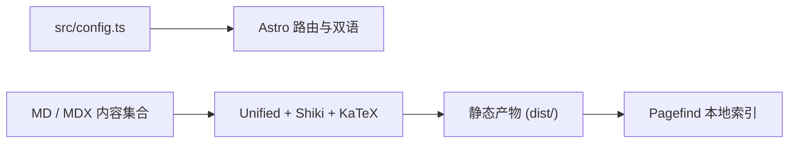

## Table of contents

## 提示框与脚注

> [!NOTE]
> Astro Orbit 支持 GitHub 风格的提示框语法（`NOTE`、`TIP`、`IMPORTANT`、`WARNING`、`CAUTION`），在亮色与暗色主题下均保证对比度清晰。

正文支持标准脚注跳转与返回锚点[^orbit-zh-fn]。

[^orbit-zh-fn]: 脚注标题与返回按钮文案会根据配置的默认语言自动适配。

## KaTeX 数学公式

行内公式如 $e^{i\pi} + 1 = 0$ 与独立块级公式均可直接书写：

$$
\mathcal{L}(\theta) = -\frac{1}{N}\sum_{i=1}^{N} \left[ y_i \log \hat{y}_i + (1 - y_i)\log(1 - \hat{y}_i) \right]
$$

## Mermaid 流程图与本地图片

