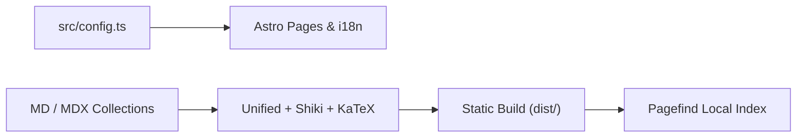

## Table of contents

## Callouts & Prose

> [!NOTE]
> Astro Orbit renders GitHub-style alerts (`NOTE`, `TIP`, `IMPORTANT`, `WARNING`, `CAUTION`) with clean accessible contrast in both light and dark modes.

> [!WARNING]
> Standard blockquotes without a `[!KIND]` prefix remain untouched so literary quotations keep their natural styling.

Footnotes remain anchored cleanly back to the paragraph where they were referenced[^orbit-fn].

[^orbit-fn]: Footnote labels and back-links automatically match your configured `defaultLocale`.

## Mathematics with KaTeX

Inline math integrates directly with prose, such as Euler's identity $e^{i\pi} + 1 = 0$, while block equations support full multi-line alignment:

$$
\mathcal{L}(\theta) = -\frac{1}{N}\sum_{i=1}^{N} \left[ y_i \log \hat{y}_i + (1 - y_i)\log(1 - \hat{y}_i) \right]
$$

## Diagrams & Architecture




## Tables & Task Lists

| Feature | Engine | Runtime Cost |
| :--- | :---: | ---: |
| Full-text Search | Pagefind + WASM | 0 external calls |
| Typography | Astro Fonts API | Self-hosted WOFF2 |
| Star Map Backdrop | Pre-compiled WGSL | Single GPU pass |

- [x] Responsive local image dimension inference
- [x] Click-to-zoom frameless lightbox
- [ ] Your next post

## Code Blocks & Folding

Short blocks display filename headers and copy buttons; blocks longer than 36 lines collapse automatically with an expand toggle:

```ts title="src/config.ts"
export interface FeatureFlags {
  notes: boolean;
  projects: boolean;
  friends: boolean;
  galleries: boolean;
  archives: boolean;
  search: boolean; // [!code highlight]
}

export function isEnabled(flags: FeatureFlags, key: keyof FeatureFlags): boolean {
  return Boolean(flags[key]); // [!code ++]
}
```

```ts title="scripts/demo-long-block.ts"
export function buildOrbitRing(count: number) {
  const points: Array<{ index: number; angle: number; x: number; y: number }> = [];
  const step = (Math.PI * 2) / Math.max(1, count);
  for (let i = 0; i < count; i += 1) {
    const angle = i * step;
    const radius = 120 + (i % 3) * 16;
    const x = Math.cos(angle) * radius;
    const y = Math.sin(angle) * radius * 0.42;
    points.push({ index: i, angle, x, y });
  }
  const normalized = points.map((pt) => ({
    ...pt,
    x: Number(pt.x.toFixed(2)),
    y: Number(pt.y.toFixed(2)),
  }));
  const bounds = normalized.reduce(
    (acc, pt) => ({
      minX: Math.min(acc.minX, pt.x),
      maxX: Math.max(acc.maxX, pt.x),
      minY: Math.min(acc.minY, pt.y),
      maxY: Math.max(acc.maxY, pt.y),
    }),
    { minX: Infinity, maxX: -Infinity, minY: Infinity, maxY: -Infinity },
  );
  const centerX = Number(((bounds.minX + bounds.maxX) / 2).toFixed(2));
  const centerY = Number(((bounds.minY + bounds.maxY) / 2).toFixed(2));
  const summary = {
    count: normalized.length,
    centerX,
    centerY,
    spanX: Number((bounds.maxX - bounds.minX).toFixed(2)),
    spanY: Number((bounds.maxY - bounds.minY).toFixed(2)),
  };
  return {
    points: normalized,
    bounds,
    summary,
  };
}
```
